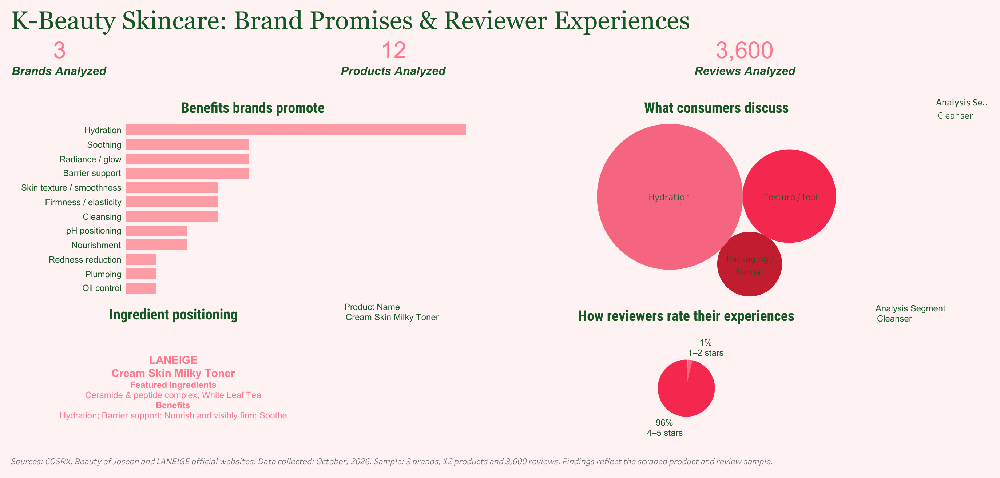
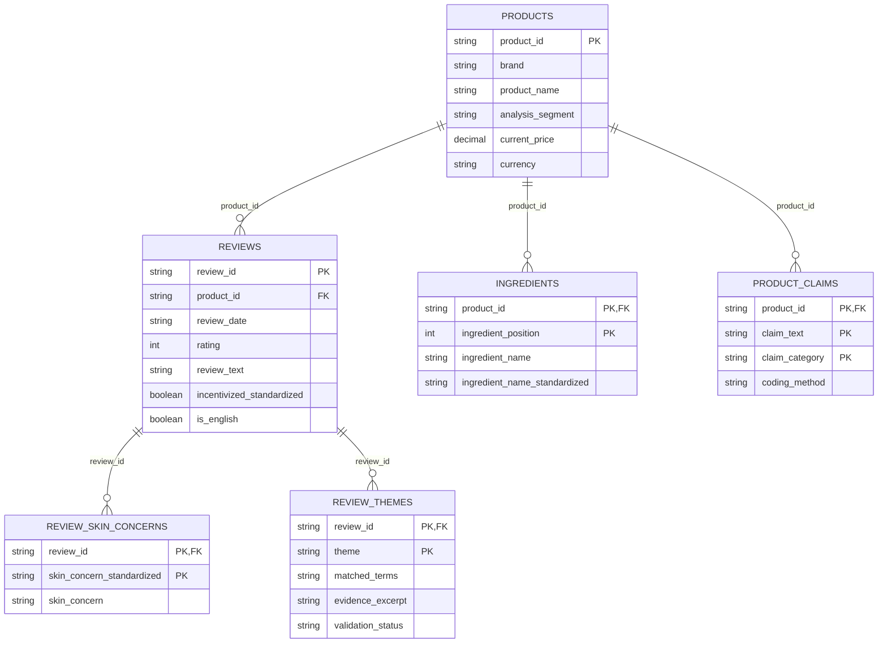

# K-Beauty Consumer Insights Analysis

### Understanding K-Beauty’s Appeal in the US: Brand Promises and Consumer Voices

An exploratory analysis of **3 brands, 12 selected skincare products, and 3,600 online reviews**, connecting the benefits brands promote with the experiences consumers discuss.

**[Explore the interactive Tableau dashboard](https://public.tableau.com/app/profile/ines.hadjem/viz/K-BeautySkincareBrandPromisesReviewerExperiences/Dashboard1)**



## Business context

Understanding consumer preferences helps skincare brands identify which product benefits resonate, where the customer experience may fall short, and how product communication can become clearer. This project examines K-beauty through two complementary sources: official product positioning and consumer reviews on brand websites serving the US online market.

The analysis focuses on a selected sample. It does not measure market size, sales, or the preferences of all US consumers.

## Research question

**How do brand positioning and consumer-reported experiences across 12 selected K-beauty products help us understand their appeal in the US online market?**

The analysis explores:

- Which benefits and ingredients brands emphasize.
- Which themes reviewers mention, including hydration, texture, sensitivity, packaging, and value.
- How ratings vary across products and review incentive status.
- Where brand messaging and consumer discussion overlap, and where further investigation could be useful.

## Dataset overview

| Measure | Scope |
| --- | --- |
| Brands | Beauty of Joseon, COSRX, LANEIGE |
| Products | 12; four per brand |
| Product segments | Cleanser, moisturizer, serum, toner/essence |
| Reviews | 3,600; 300 per product |
| Sources | Official brand product pages and their review platforms, including Okendo and Yotpo |
| Theme-analysis coverage | 3,566 reviews marked English; 34 excluded from theme tagging because language was non-English or unknown |

The collection targets up to 300 of the most recent reviews per product. Equal sample sizes support descriptive comparisons but do not reflect relative sales or popularity. The dashboard labels collection as October 2026; some notebook provenance notes reference September 2026. Review publication dates span different periods by product, documented in `data/analysis/review_time_windows.csv`.

### Selected products

| Brand | Segment | Product |
| --- | --- | --- |
| Beauty of Joseon | Cleanser | Green Plum Refreshing Cleanser |
| Beauty of Joseon | Moisturizer | Dynasty Cream |
| Beauty of Joseon | Serum | Glow Serum : Propolis + Niacinamide |
| Beauty of Joseon | Toner | Ginseng Essence Water |
| COSRX | Cleanser | Low pH Good Morning Gel Cleanser |
| COSRX | Moisturizer | Advanced Snail 92 All in One Cream |
| COSRX | Serum | The 6 Peptide Skin Booster Serum |
| COSRX | Toner | Full Fit Propolis Synergy Toner |
| LANEIGE | Cleanser | Water Bank Gentle Gel Cleanser |
| LANEIGE | Moisturizer | Water Bank Blue Hyaluronic Cream Moisturizer |
| LANEIGE | Serum | Water Bank Blue Hyaluronic Serum |
| LANEIGE | Toner | Cream Skin Milky Toner |

## Methodology

1. **Test collection:** Retrieve a single product and its reviews to validate extraction and table relationships.
2. **Collect the full sample:** Extract product information, ingredient lists, review text, ratings, and available reviewer metadata across the 12 products. Retain source URLs and variant information where available.
3. **Clean and validate:** Standardize formatting, skin-type and skin-concern labels, language, and available verification/incentive flags. Preserve unknown values. Check unique identifiers, rating ranges, row counts, duplicate relationship pairs, and orphan records.
4. **Explore the data:** Compare product ratings, incentive status, review time windows, and reported skin types; inspect selected review excerpts.
5. **Code review themes:** Apply iterative, case-insensitive keyword rules to eligible English reviews. Allow multiple themes per review and retain matched terms and evidence excerpts. Revise rules after inspecting 30 matched excerpts and nine unmatched reviews, recording one manual exclusion.
6. **Categorize brand promises:** Manually map collected benefit statements to claim categories, preserving the original benefits and product-page sources.
7. **Visualize in Tableau:** Relate exported tables to compare promoted benefits, ingredient positioning, review themes, and rating distributions by segment or product.

### Relational data design

The project implements a relational model in **CSV tables**, connected through `product_id` and `review_id`. It does not include a deployed SQL database.

| Tableau table | Rows | Role |
| --- | ---: | --- |
| `products.csv` | 12 | Product attributes; one row per product |
| `reviews.csv` | 3,600 | Review records linked to products |
| `ingredients.csv` | 346 | Ordered ingredient entries linked to products |
| `review_skin_concerns.csv` | 4,277 | Review–skin-concern relationships |
| `review_themes.csv` | 3,374 | Unique review–theme pairs |
| `product_claims.csv` | 41 | Product claim–category assignments |

One product can have many reviews, ingredients, and claim assignments; one review can have multiple concerns and themes. In Tableau, use relationships and distinct product/review counts to avoid inflating measures when combining these tables.

### Relationship diagram



**How to read it:** Each product connects to zero or more reviews, ingredient entries, and claim assignments. Each review connects to zero or more skin concerns and themes. Every child record belongs to exactly one parent. The diagram shows selected fields; CSV headers contain the complete field lists.

`PK` identifies a logical primary key, and `FK` identifies a foreign key. Multiple `PK` fields in one table form a composite key. These keys describe the validated CSV model; they are not SQL constraints enforced by a database engine. The types shown describe field meaning; CSV files do not enforce data types, and boolean metadata can be unknown.

## Key findings

**Hydration is the strongest overlap between brand promises and reviewer discussion.** It appears in the manually coded benefits of **11 of 12 products** and is the most frequent keyword theme, occurring in **1,481 of 3,566 eligible English reviews (41.5%)**.

| Review theme | Reviews mentioning theme | Share of eligible English reviews |
| --- | ---: | ---: |
| Hydration | 1,481 | 41.5% |
| Texture / feel | 756 | 21.2% |
| Sensitivity / breakouts | 702 | 19.7% |
| Packaging / format | 332 | 9.3% |
| Price / value | 103 | 2.9% |

Themes can overlap, so percentages are not parts of a single whole. These are **mentions**, not sentiment scores or complaint rates. For example, sensitivity tagging includes references to gentleness, sensitive skin, and negated reactions.

**Ratings are strongly positive within the collected sample:** 3,470 of 3,600 reviews (**96.4%**) give four or five stars. This describes reviews observed on brand websites; it does not establish independent satisfaction or clinical effectiveness. Incentivized-review prevalence varies by product, and unknown incentive status is retained separately.

**Business interpretation:** Hydration offers a useful starting point for studying message–experience alignment. Texture and sensitivity deserve further qualitative investigation, while packaging and value can reveal practical experience considerations. These are exploratory directions for research, not proven drivers of purchase or repeat purchase.

## Dashboard

The [Tableau Public dashboard](https://public.tableau.com/app/profile/ines.hadjem/viz/K-BeautySkincareBrandPromisesReviewerExperiences/Dashboard1) presents:

- Benefits brands promote.
- Themes consumers discuss.
- Ingredient positioning and product benefit statements.
- Reviewer rating distributions.
- Product and analysis-segment controls.

The screenshot captures selected filter states; interact with the dashboard to explore other views.

## Tools and technologies

- **Python:** Collection, cleaning, validation, and exploratory analysis.
- **pandas:** Tabular transformations and relational checks.
- **requests and Beautiful Soup:** Web requests and HTML/structured-data parsing.
- **Jupyter notebooks:** Documented analytical workflow and saved outputs.
- **Tableau Public:** Interactive visualization and presentation.
- **GitHub:** Project organization, documentation, and version control.

## Project structure

The layout below describes the complete local project package. This GitHub repository currently publishes the README, dashboard image, and setup files. Notebooks and data have not been uploaded.

```text
.
├── README.md
├── requirements.txt
├── notebooks/
│   ├── 01_test_product_collection.ipynb
│   ├── 02_collect_all_products.ipynb
│   ├── 03_clean_and_validate.ipynb
│   ├── 04_exploratory_analysis.ipynb
│   └── 05_theme_analysis_tableau.ipynb
├── data/
│   ├── processed/all_products/  # Combined collection tables
│   ├── cleaned/all_products/    # Validated, standardized tables
│   ├── analysis/                # Summaries and theme-method records
│   └── tableau/                 # Six final relational tables
└── assets/
    └── dashboard.png
```

## Explore and reproduce

The notebooks in the local project package retain their original code and saved outputs. To inspect the work, open them in order from `01` through `05`; use the local CSV exports to examine the saved analytical snapshot without collecting again.

To run locally:

```bash
python -m venv .venv
source .venv/bin/activate
pip install -r requirements.txt
jupyter lab
```

**Configure paths before execution.** Several notebooks reference `Path.home() / "K-Beauty_Analysis"`, while collection cells use relative `data/` paths. Set these locations to your cloned repository root and launch Jupyter from that root. Dependencies are listed without pinned versions because the original execution environment was not captured; exact environment reproduction is not guaranteed.

For the existing snapshot, start with notebook `03` using `data/processed/all_products/`, then run `04` and `05` in order. To recollect, review notebooks `01` and `02` first: they contain exploratory cells, source-specific identifiers, and manually verified product details. They are a documented collection workflow rather than a single unattended scraping script. Recollection requires network access and may produce different results as websites and review feeds change.

For Tableau, connect the six files in `data/tableau/` using their identifier relationships. The published dashboard is linked above; a Tableau workbook file is not included.

## Limitations

- **Sample scope:** Three selected brands and 12 products cannot represent the entire K-beauty industry or US consumer population. Reviewer residence is not established by a US-facing storefront.
- **Selection and platform effects:** Brand-hosted reviews may reflect self-selection, moderation, and incentives. Verification and disclosure fields differ across platforms; missing metadata does not mean absence of incentives.
- **Different review windows:** The latest 300 reviews can cover different periods for each product, limiting direct comparisons.
- **Exploratory text rules:** Keyword tagging does not resolve context, negation, sentiment, or causation. The small rule-development sample is not an independent validation set; accuracy and recall were not estimated. No match does not prove a theme is absent.
- **Unequal taxonomies:** Brand claims and review themes are coded differently. Their overlap is descriptive rather than a formal measure of promise fulfillment.
- **Variant and formula mismatch:** Product prices and ingredients describe selected variants at collection; reviews can refer to other sizes, formats, or historical formulations.
- **Source content:** Product descriptions and review text originate from the cited brands and reviewers. Their inclusion does not imply ownership or a grant of reuse rights. No license is assigned to third-party content.

## Author

**Ines Hadjem** · [GitHub](https://github.com/ines-hdjm) · [Tableau dashboard](https://public.tableau.com/app/profile/ines.hadjem/viz/K-BeautySkincareBrandPromisesReviewerExperiences/Dashboard1)

