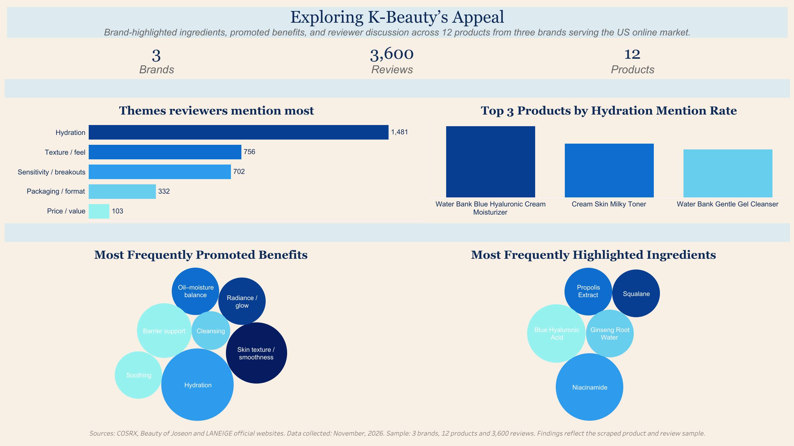
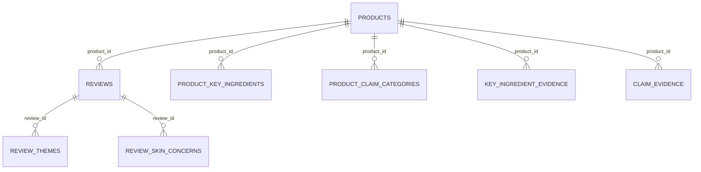

# Exploring K-Beauty's Appeal

**Brand-highlighted ingredients, promoted benefits, and reviewer discussion across 12 selected products serving the US online market.**

I collected and analyzed product information and 3,600 brand-site reviews from **Beauty of Joseon, COSRX and LANEIGE**, using Python, pandas and Tableau. The November positioning update combines captured website text with manually reviewed screenshots; it is not an entirely automated scrape.

**[Explore the Tableau dashboard](https://public.tableau.com/views/ExploringK-BeautysAppeal/Dashboard1)**



## Research question and context

How do brand positioning and consumer-reported experiences across 12 selected K-beauty products help us understand their appeal in the US online market?

[Euromonitor's August 2026 article](https://www.euromonitor.com/newsroom/press-releases/august-2026/k-beauty-global-growth-beauty-market-2026) reports that the US accounted for **54% of K-beauty overseas online sales in 2025**. This motivates the project; the selected review sample does not independently measure market demand, reviewer residence, sales, or causal reasons for purchase.

## Sample

- **3 brands**, with four selected products each.
- **12 products** covering cleanser, moisturizer, serum and toner/essence segments.
- **3,600 reviews**, 300 per product, collected from official brand sites and review platforms including Okendo and Yotpo.
- **3,566 eligible English reviews** for keyword theme analysis; 34 non-English or unknown-language reviews retained but not tagged.

| Brand | Cleanser | Moisturizer | Serum | Toner / essence |
| --- | --- | --- | --- | --- |
| Beauty of Joseon | Green Plum Refreshing Cleanser | Dynasty Cream | Glow Serum: Propolis + Niacinamide | Ginseng Essence Water |
| COSRX | Low pH Good Morning Gel Cleanser | Advanced Snail 92 All in One Cream | The 6 Peptide Skin Booster Serum | Full Fit Propolis Synergy Toner |
| LANEIGE | Water Bank Gentle Gel Cleanser | Water Bank Blue Hyaluronic Cream Moisturizer | Water Bank Blue Hyaluronic Serum | Cream Skin Milky Toner |

Equal review sample sizes support descriptive comparisons, not relative popularity. Review publication windows differ across products. **Positioning was updated in November 2026; reviews belong to the earlier research snapshot.** Original notebook notes and old documentation contain September/October references, so the exact original collection month is not reconciled here. The dashboard's November footer describes the latest project update, not evidence that all reviews were collected then.

## Dashboard: four views and three KPIs

The final dashboard presents **3 brands, 3,600 reviews and 12 products**, followed by:

1. **Themes reviewers mention most:** distinct review counts by keyword theme.
2. **Top 3 products by hydration mention rate:** hydration-tagged reviews divided by all eligible reviews for each product.
3. **Most frequently promoted benefits:** product counts for seven skin-benefit categories assigned to at least two products.
4. **Most frequently highlighted ingredients:** product counts for five standardized ingredient labels highlighted by at least two products.

Bubble area represents distinct product count; colors distinguish labels and are not a second quantitative measure. The final dashboard does not include a rating distribution chart. Ratings and incentive analysis remain exploratory notebook work.

## Findings

**Hydration is prominent in both brand positioning and reviewer discussion.** Under the revised, single-category coding, 7 of 12 products have a Hydration-coded claim. Hydration is mentioned in 1,481 of 3,566 eligible reviews (41.5%). These have different units and denominators; their overlap is descriptive, not a claim-fulfillment score.

| Review theme | Distinct reviews | Share of eligible reviews |
| --- | ---: | ---: |
| Hydration | 1,481 | 41.5% |
| Texture / feel | 756 | 21.2% |
| Sensitivity / breakouts | 702 | 19.7% |
| Packaging / format | 332 | 9.3% |
| Price / value | 103 | 2.9% |

Themes overlap. Mentions do not resolve sentiment, negation, satisfaction, clinical outcomes or causation. Sensitivity includes gentleness and negated reactions.

| Top hydration-discussion products | Tagged / eligible reviews | Rate |
| --- | ---: | ---: |
| Water Bank Blue Hyaluronic Cream Moisturizer | 242 / 297 | 81.5% |
| Cream Skin Milky Toner | 183 / 297 | 61.6% |
| Water Bank Gentle Gel Cleanser | 166 / 300 | 55.3% |

Each rate uses that product's eligible reviews, including those with no matched theme in the denominator. These figures do not show which product hydrates best.

Among highlighted ingredients, **Niacinamide appears in 4 products**, **Blue Hyaluronic Acid in 3**, and **Ginseng Root Water, Propolis Extract and Squalane in 2 each**. These are brand-highlighted labels, not a comparison of full formulas or concentrations.

**Interpretation:** hydration is a useful starting point for qualitative investigation of messaging and reviewer discussion. Texture, sensitivity, packaging and value provide additional research directions. The analysis does not establish purchase or repeat-purchase drivers.

## Workflow and new ingredient/claim model

1. Test product/review extraction and collect the selected sample.
2. Standardize product and review metadata while preserving unknown values; validate keys and relationships.
3. Explore ratings, incentives, review windows and reviewer metadata.
4. Apply iterative English keyword rules, retaining matches and evidence excerpts locally. Development inspected 30 matched excerpts and nine unmatched reviews and recorded one exclusion; no independent accuracy estimate was produced.
5. Capture highlighted ingredients and selected brand claims from November page text/screenshots. Record one ingredient or claim entry per row, preserving source wording and available descriptions.
6. Assign **exactly one standardized category per claim**. Use the heading's main message, the description to clarify ambiguous headings, and the first explicit benefit for equally weighted compound statements. Separate Skin benefit, Usage and Testing statement labels.
7. Preserve the original ingredient label and percentage; apply explicit comparison-name mappings. The two snail labels are grouped for marketing analysis, without asserting chemical equivalence. Keep other peptide and complex labels distinct.
8. Export evidence tables plus deduplicated membership tables, validate, then relate tables in Tableau.

The historical claims workflow assigned Hydration to 11 products. The revised source selection and one-category rule yield 7; this is a methodology difference, not a change in product effectiveness. [Detailed schema and provenance](docs/data_model.md).

### Current CSV model

| Local table | Rows | Grain |
| --- | ---: | --- |
| products.csv | 12 | One product |
| reviews.csv | 3,600 | One review |
| review_skin_concerns.csv | 4,277 | One review / concern |
| review_themes.csv | 3,374 | One review / theme |
| key_ingredient_evidence.csv | 37 | One original highlighted ingredient entry |
| product_key_ingredients.csv | 36 | One product / standardized ingredient |
| claim_evidence.csv | 44 | One product / original claim; 36 skin benefits, 4 usage, 4 testing |
| product_claim_categories.csv | 41 | One product / category / claim type; 33 skin-benefit pairs |

Historical `ingredients.csv` retains 346 ordered full-formula entries; historical `product_claims.csv` retains 41 earlier multi-category assignments. Neither substitutes for the new dashboard membership tables. The two tables with 41 rows have different meanings.



This is a relational **CSV model**, not a deployed SQL database. Use Tableau relationships and distinct counts rather than physically joining multiple child tables. [Dashboard calculations](docs/dashboard.md).

## Repository structure

```text
notebooks/
  01_test_product_collection.ipynb
  02_collect_all_products.ipynb
  03_clean_and_validate.ipynb
  04_exploratory_analysis.ipynb
  05_theme_analysis_tableau.ipynb
  06_ingredients_and_claims_revised.ipynb
docs/
  data_model.md
  dashboard.md
  notebook_provenance.json
data/README.md                 # Local input/output contract; no review datasets
scripts/validate_snapshot.py   # Local CSV checks and aggregate reconciliation
assets/dashboard.png
requirements.txt
```

Notebooks are published without saved outputs to avoid redistributing review text and reviewer details. Local originals are unchanged. Publication copies add configurable paths; notebook 06 removes the failed duplicate Dynasty live request and defaults to captured cleanser text, so its enrichment stage can run offline. [Publication change record](docs/notebook_provenance.json).

## Explore and reproduce

```bash
python -m venv .venv
source .venv/bin/activate
python -m pip install -r requirements.txt
jupyter lab
```

Open notebooks from the repository root or `notebooks/`. `KBEAUTY_PROJECT_ROOT` optionally points at a separate local project/data folder. Dependencies are not pinned because the historical environment was not captured; exact environment reproduction is not guaranteed.

- **Inspect the original workflow:** notebooks 01–05 retain the original exploratory logic. Run in order with the local inputs described in [data/README.md](data/README.md). Collection is source-specific and not guaranteed to run unattended against today's sites. Original export cells can overwrite local files; use a copy of your snapshot.
- **Reuse the original review snapshot:** supply `data/processed/all_products/`, run 03 and 04, then the first four original code cells of 05 for review-theme exports. Its final two original code cells retain the older claim approach for historical context.
- **Rebuild revised positioning:** notebook 06 uses embedded, manually reviewed product statements and captured cleanser text. Supply `data/tableau/products.csv` or set `KBEAUTY_PRODUCTS_CSV`. It creates the four new tables in a fresh timestamped `data/tableau_key_ingredients_claims/` directory and checks CSV round trips. Live cleanser refresh is explicitly optional and changes source timing.
- **Check final exports:** `python scripts/validate_snapshot.py --data-dir /path/to/final/csv/folder`. Numbered filenames from the author's Desktop exports are recognized; canonical names also work. Real review datasets are local and not included, so cloning alone cannot reproduce historical review counts.

No fresh collection was performed for this repository update. Notebook 06 is executed offline against local product IDs and reconciled with the four existing exports. Original notebooks are syntax-checked, not rerun against live sites. Validation details are reported in the pull request.

## Limitations and responsible use

- **Scope:** selected brands/products and brand-hosted reviews cannot represent the entire US market. Reviewer location is not established.
- **Selection and incentives:** self-selection, moderation and incentives may affect review content. Unknown metadata is not evidence of no incentive. Equal sample sizes are not market share.
- **Source timing:** November positioning and older reviews are separate snapshots. Review windows differ; processing timestamps do not identify original capture time.
- **Variants:** the revised COSRX serum uses a bundle source; the LANEIGE cream screenshot shows a Matin Kim variant. These mappings require caution when comparing with original product/price records or historical formulas.
- **Coverage and coding:** LANEIGE icon benefits differ in detail from other brands' text; closed benefit panels were not inferred. A single-category rule omits secondary benefits from category counts. Missing descriptions remain missing.
- **Methods:** keyword mentions are exploratory and do not measure sentiment, fulfillment or efficacy. Broad highlighted labels/complexes are not identical chemicals, functional classifications or full-formula evidence.
- **Third-party content:** product statements originate with brands and review text with reviewers. No rights to their content are asserted. Raw review datasets, personal reviewer details and screenshots of source pages are not redistributed here. Check applicable terms, rate limits and data-use requirements before recollection; stop on HTTP 429 rather than repeatedly retrying.

## Author

**Ines Hadjem** · [GitHub](https://github.com/ines-hdjm) · [Tableau dashboard](https://public.tableau.com/views/ExploringK-BeautysAppeal/Dashboard1)
